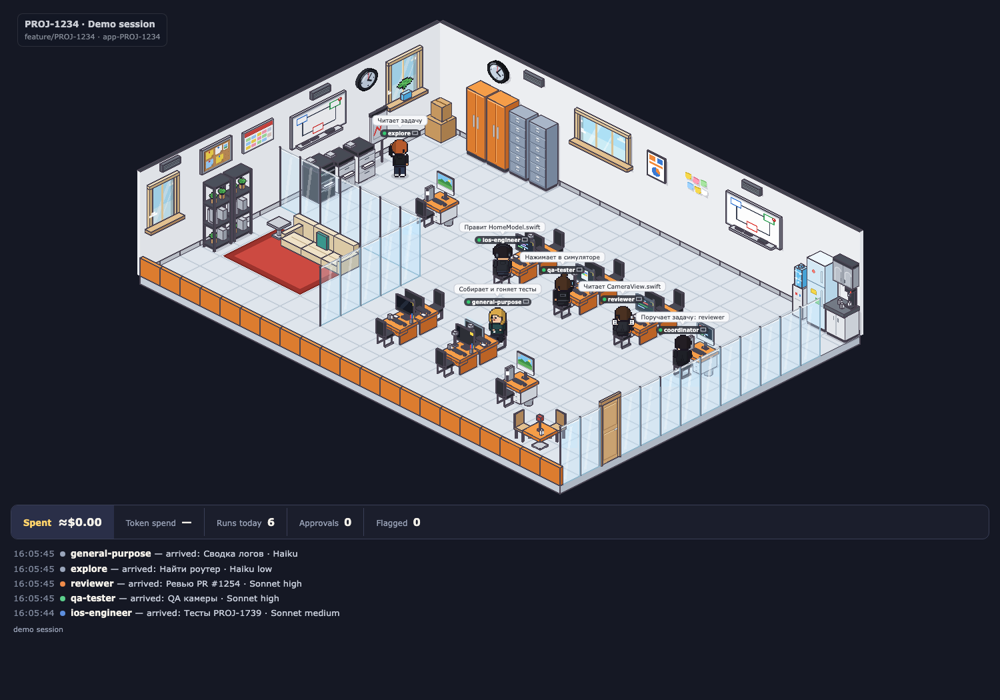
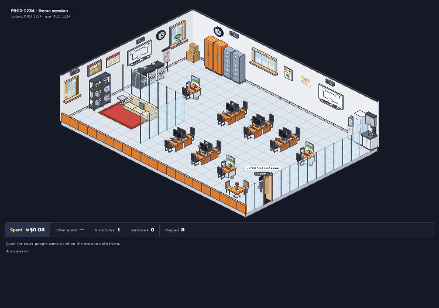
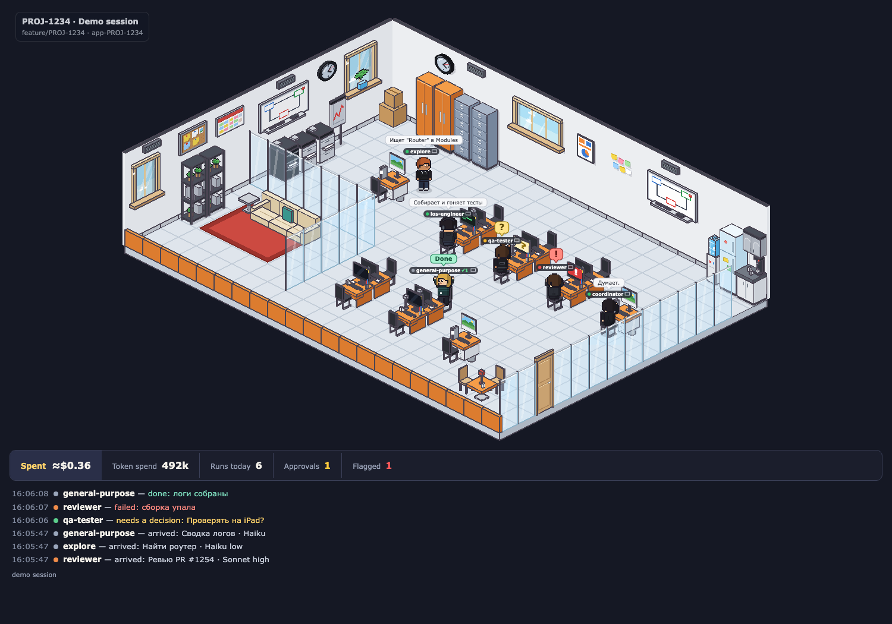
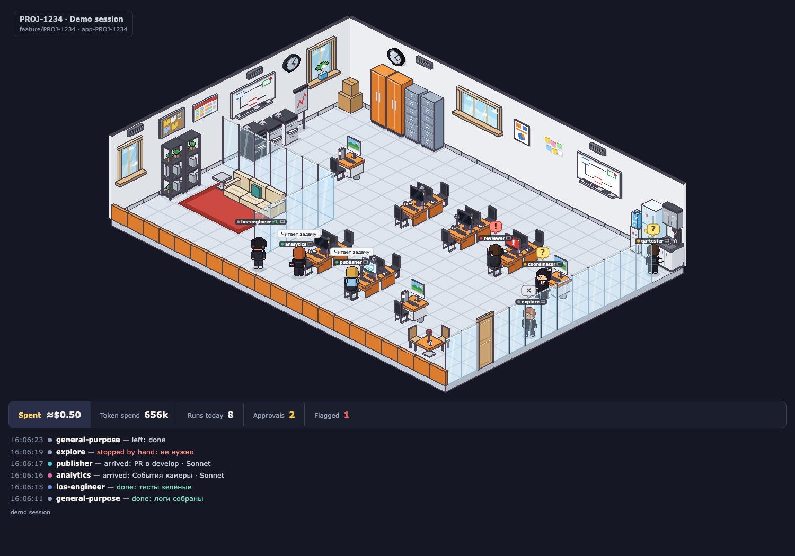
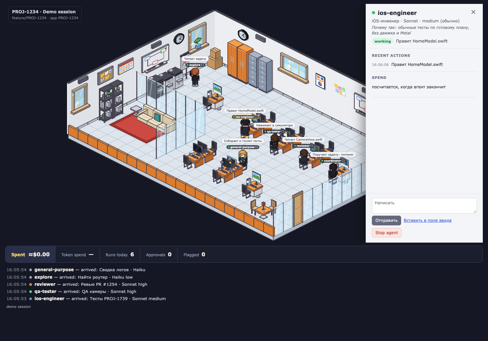
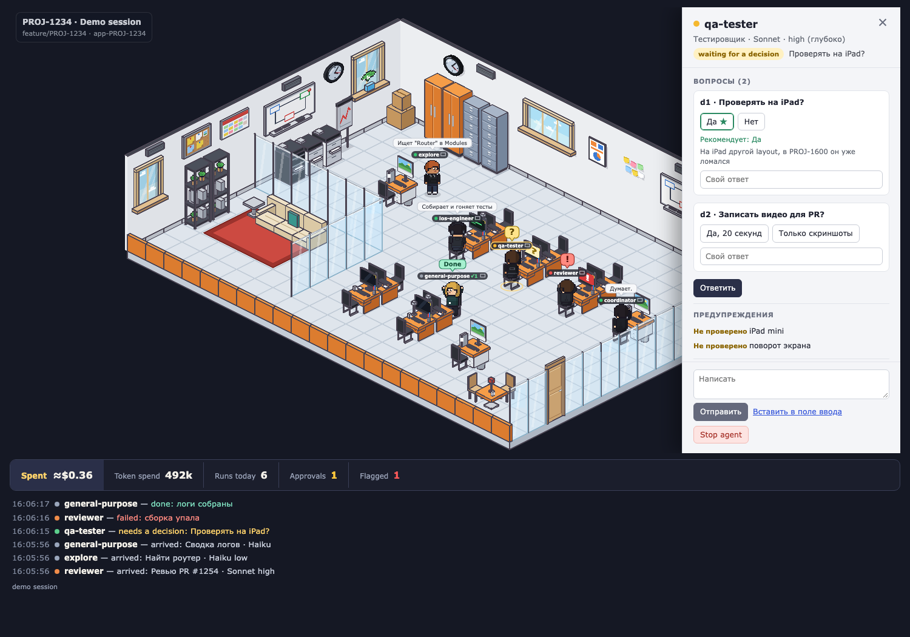
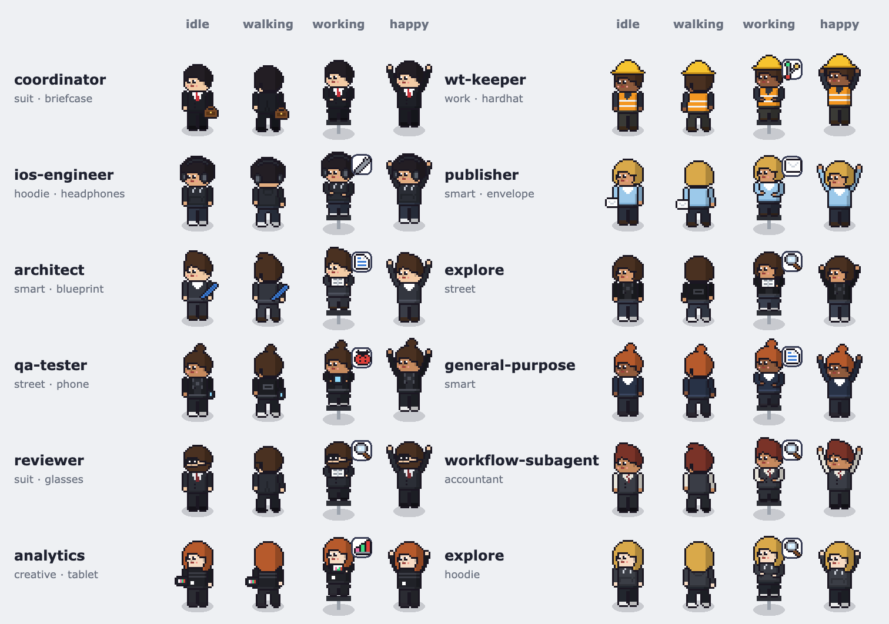
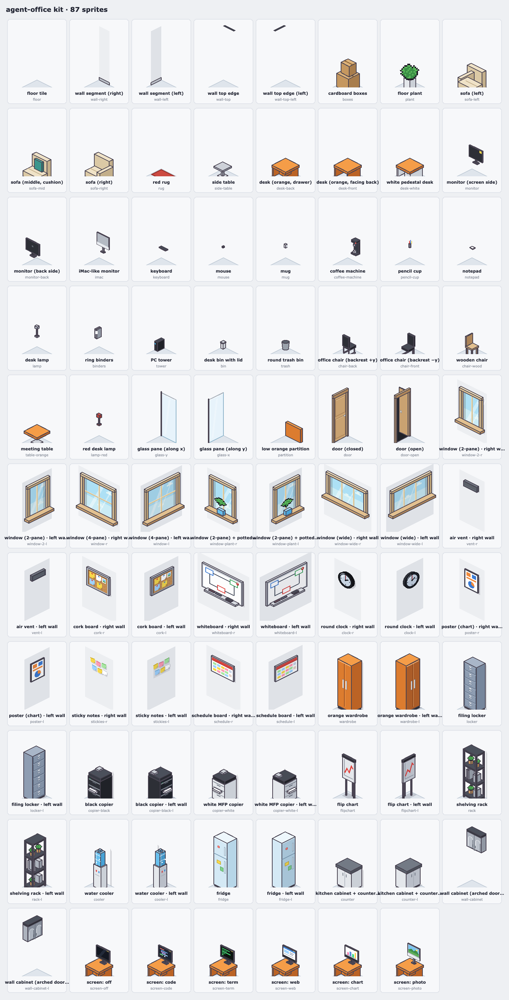
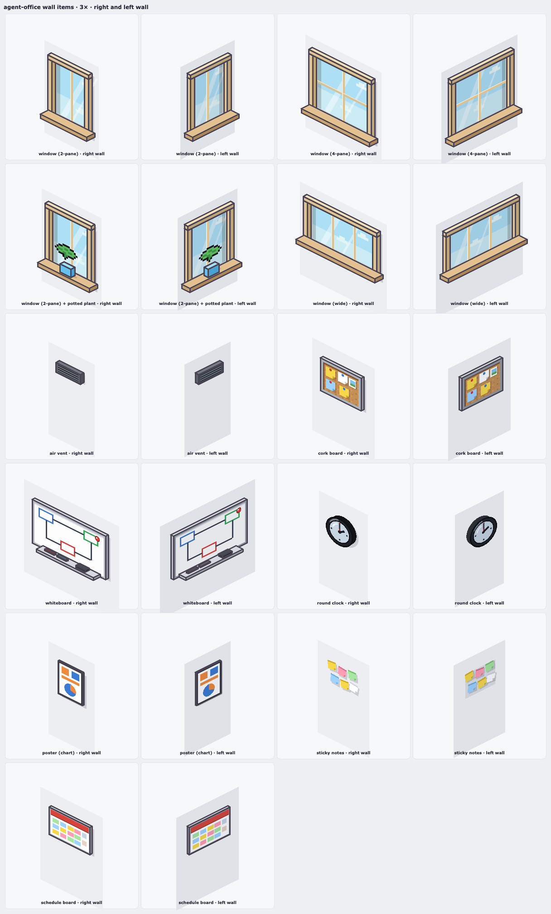

# agent-office

A Claude Code mod (a plugin of function hooks) that draws every agent of the session as a little pixel person in an animated isometric pixel-art office. The office is a local web page that opens in the system browser; the mod's own pane, **«Офис»**, holds a short summary and the link to it.

**It works only with Claude Code.** It is a Claude Code mod and reads Claude Code's own session events (prompts, tool calls, subagent spawns and results); it does not work with other AI tools, IDE agents or chat apps.

## Install

### Requirements

| What | Version | Why |
|---|---|---|
| Claude Code (CLI or the desktop app) | 2.1.287 or newer: the release that added mods (plugins of function hooks) | the office is a mod; tested on 2.1.282 (CLI, with function hooks turned on) and 2.1.293 (desktop app) |
| Node.js **or** Python 3 | Node.js 18+, or Python 3.8+ | runs the small local web server; Node.js is tried first, Python is the fallback |
| A web browser | any current one | shows the office page |
| git | any | to clone the repository |

Operating systems: **tested on macOS only** (Apple Silicon, Homebrew node). Linux should work: node is found in the usual places, the page opens with `xdg-open`, and the server only uses the loopback, but it has not been tried. Windows has not been tried and is not expected to work as is (paths, `open`, the atomic rename through `/bin/mv`).

If your Claude Code build says hooks modules are not turned on (early access), start it with `CLAUDE_CODE_ENABLE_FUNCTION_HOOKS=1` in its environment.

### Get it running

The simplest way: in a Claude Code session, add this repo as a plugin marketplace and install from it. Updates then come with `/plugin marketplace update`.

```
/plugin marketplace add oleg-kalistratov/agent-office
/plugin install agent-office@agent-office
```

Or from a clone:

```sh
git clone https://github.com/oleg-kalistratov/agent-office.git
claude --plugin-dir "$PWD/agent-office"
```

That loads the mod for one terminal session. For every session, including the ones the desktop app starts, name the folder in `CLAUDE_CODE_PLUGIN_DIRS`, in the process environment or in the `env` block of your user settings file, `~/.claude/settings.json` (several folders are separated with `:`):

```json
{ "env": { "CLAUDE_CODE_PLUGIN_DIRS": "/absolute/path/to/agent-office" } }
```

Then type **`/office`** in the session: it starts the local server and opens the office in your browser. The «Офис» pane also opens by itself at session start where the surface docks panes. There is nothing to configure after install.

When something is missing, `/office` and the pane say what and how to fix it: no Node.js or Python, a version that is too old, a local port that cannot be opened, a data folder that is not writable, or a browser that cannot be opened (then you get the link). The message is in Russian when the session is Russian, in English when it is English, and in both when the mod cannot tell. A build with mods turned off does not load the mod at all, so it cannot say so itself: then `/office` is simply an unknown command.

### Without a team and with one

- **Without an agent team** (any Claude Code setup): the office shows the main Claude at its desk: working, thinking, asking you, done, coffee after five idle minutes. Every subagent the session starts (`Explore`, `Plan`, `general-purpose`, any plugin's agent) walks in as a contractor with its own type as the name tag, works at a hot desk and leaves when done. Built-in types have their own look; an unknown type shows its own name and a generic look.
- **With an agent team** (optional): the agents of the `ios-team` plugin (`ios-team:<role>`) are staff with their own desks, outfits and Russian role names, and the main agent becomes the `coordinator` once the `ios-team:project-lead` skill runs or the first subagent is spawned. Click a person to open their card: it shows the model and the reasoning effort (from the agent's own steps, the effort the Agent call asked for, or the `effort:` line of the agent's definition file), and, when the coordinator writes a `route: <model> <effort> — <reason>` line in the first five lines of the agent's prompt, the reason under «Почему так». Agents of other teams are shown too, as contractors under their own names.

### License

Apache License 2.0: see [LICENSE](LICENSE) and [NOTICE](NOTICE).

## Установка

**Работает только с Claude Code.** Это мод Claude Code, он читает события самой сессии Claude Code (сообщения, вызовы инструментов, запуски и результаты субагентов); с другими ИИ-инструментами, агентами в IDE и чатами он не работает.

### Что нужно

| Что | Версия | Зачем |
|---|---|---|
| Claude Code (CLI или десктоп-приложение) | 2.1.287 или новее: в этой версии появились моды (плагины с функциональными хуками) | офис — это мод; проверено на 2.1.282 (CLI, с включёнными функциональными хуками) и 2.1.293 (десктоп) |
| Node.js **или** Python 3 | Node.js 18+ или Python 3.8+ | на нём работает маленький локальный веб-сервер; сначала пробуется Node.js, Python — запасной вариант |
| Браузер | любой современный | в нём открывается офис |
| git | любой | чтобы склонировать репозиторий |

Системы: **проверено только на macOS** (Apple Silicon, node из Homebrew). На Linux должно работать: node ищется в обычных местах, страница открывается через `xdg-open`, сервер слушает только loopback, но это не проверялось. Windows не проверялась, и как есть, скорее всего, не заработает (пути, `open`, атомарная замена файла через `/bin/mv`).

Если Claude Code пишет, что hooks modules не включены (ранний доступ), запусти его с `CLAUDE_CODE_ENABLE_FUNCTION_HOOKS=1` в окружении.

### Запуск

Проще всего: в сессии Claude Code добавь этот репозиторий как маркетплейс плагинов и поставь из него. Обновления потом приходят командой `/plugin marketplace update`.

```
/plugin marketplace add oleg-kalistratov/agent-office
/plugin install agent-office@agent-office
```

Или из клона:

```sh
git clone https://github.com/oleg-kalistratov/agent-office.git
claude --plugin-dir "$PWD/agent-office"
```

Так мод загрузится для одной сессии в терминале. Для всех сессий, в том числе тех, что запускает десктоп-приложение, укажи папку в `CLAUDE_CODE_PLUGIN_DIRS` — в окружении процесса или в блоке `env` пользовательского файла настроек `~/.claude/settings.json` (несколько папок разделяются `:`):

```json
{ "env": { "CLAUDE_CODE_PLUGIN_DIRS": "/полный/путь/к/agent-office" } }
```

Потом набери в сессии **`/office`**: он запустит локальный сервер и откроет офис в браузере. Панель «Офис» открывается и сама при старте сессии там, где поверхность умеет закреплять панели. После установки ничего настраивать не нужно.

Если чего-то не хватает, `/office` и панель говорят, чего именно и как это исправить: нет Node.js и Python, слишком старая версия, не открывается локальный порт, папка данных недоступна для записи или не открылся браузер (тогда дают ссылку). Сообщение на русском, если сессия на русском, на английском, если на английском, и на обоих, если мод не может понять. Если в сборке моды выключены, мод вообще не загружается и сам сказать об этом не может: тогда `/office` — просто неизвестная команда.

### Без команды и с командой

- **Без команды агентов** (любая настройка Claude Code): в офисе сидит главный Claude — работает, думает, спрашивает тебя, заканчивает, уходит за кофе после пяти минут простоя. Каждый субагент сессии (`Explore`, `Plan`, `general-purpose`, агент любого плагина) приходит как подрядчик, с названием своего типа на бейдже, работает за свободным столом и уходит, когда закончил. У встроенных типов свой вид; неизвестный тип показывает своё имя и обычный вид.
- **С командой агентов** (необязательно): агенты плагина `ios-team` (`ios-team:<роль>`) — штатные сотрудники со своими столами, одеждой и русскими названиями ролей, а главный агент становится `coordinator`, когда запускается навык `ios-team:project-lead` или первый субагент. Нажми на человека, чтобы открыть карточку: в ней модель и уровень рассуждений (из шагов самого агента, из effort, который попросил вызов Agent, или из строки `effort:` в файле определения агента), а если координатор пишет в первых пяти строках задания строку `route: <модель> <effort> — <причина>`, то и причина в блоке «Почему так». Агенты других команд тоже видны, как подрядчики под своими именами.

### Лицензия

Apache License 2.0: см. [LICENSE](LICENSE) и [NOTICE](NOTICE).

## The office



















The clip is also in `docs/preview/html-clip.mp4`; `docs/preview/html-1-arrivals.png` … `html-6-later.png` are stills of the demo session, `html-7-card.png` and `html-8-question.png` show the Agent Details card, and `html-props.png` the props check.

All sprites and furniture are original pixel art, drawn in code as ASCII pixel maps (`hooks/sprites.ts`) and iso boxes (`hooks/kit.ts`, `hooks/kit-wall.ts`). The mod uses no third-party assets, and the page loads nothing from the network.

The office is built like a puzzle from a **kit** of 70 separate isometric sprites. Each sprite has its own footprint in tiles, a blocking flag, an anchor and a depth bias, and is drawn once as a symbol. The kit covers:

- walls: floor tile, wall segments, wall top edges, windows (2-pane, 4-pane, wide, and 2-pane with a potted plant on the sill), air vent, cork board, whiteboard, round clock, poster, sticky notes, schedule board;
- furniture: wardrobe, locker, copiers, flip chart, boxes, rack, sofa parts, rug, side table, kitchen pieces (water cooler, fridge, base cabinet with countertop, coffee machine, wall cabinet), glass panes, partition, door;
- workstations: two desk types, the white pedestal desk, monitors, iMac, keyboard, mouse, mug, pencil cup, notepad, lamp, binders, PC tower, bins, chairs, meeting table, red lamp.

Wall items and big furniture have **volume**, drawn the same way throughout:

- a 1-px dark outline on every face;
- three tones per surface, with the light always from the upper left: the top face is lightest, then the lit face, then the dark side face;
- visible thickness: a protruding item shows its top face and one side face;
- a soft contact shadow on the wall under and to the right of protruding items, and on the floor under furniture.

Each wall item comes in **two orientations**, for the left wall and for the right wall. Both are drawn from the same model, measured along the wall, down the wall and out of it, and projected onto that wall. The skew is therefore right for each wall, and so is the light. On the right wall a front face is the lit face, with a darker side face on its right. On the left wall the front face is the darker one, and the lit side face is on its left. The two orientations are not mirror images. The big furniture works the same way: `wardrobe`, `locker`, the copiers, `flipchart`, `rack`, `cooler`, `fridge`, `counter` and `wall-cabinet` each have a right-wall sprite and a `-l` left-wall sprite.

- **Windows**: a thick beige frame with depth; an inner reveal (a darker band of wall thickness on two sides); mullions with a highlight on one edge; light-blue glass that follows the time of day, with drifting clouds by day, stars at night, and two diagonal reflection streaks; a protruding sill with a light top and a darker front, and a thin shadow under it. The plant variant has a blue pot standing on the sill.
- **Clock**: a thick black rim with a side band for depth, a highlight arc at the upper left, a blue-grey face with a reflection, live hour and minute hands and a moving second hand, and a small shadow on the wall.
- **Air vent**: a protruding dark-grey frame with a lighter top edge and a darker side, and louvre slats with a light top line and a dark under line.
- **Cork board**: a silver frame with depth, speckled orange-brown cork, pinned notes with folded corners and pins, and a small photo.
- **Whiteboard**: an aluminium frame with edge thickness, the coloured diagram, a magnet, and a protruding marker tray with two markers and an eraser on it.
- **Poster**: a white chart sheet in a thin frame, with an offset shadow. **Sticky notes**: separate notes, slightly turned, each with a folded corner and a tiny shadow. **Schedule board**: framed, with a red header and a grid of coloured cells.
- **Wardrobe**: a door split, silver bar handles with a highlight, and a dark plinth. **Filing locker**: drawers, each with a handle and a label slot. **Wall cabinet**: raised arched door panels and a dark top band. **Base cabinet**: a countertop with edge thickness. **Fridge**: a door gap, handles and magnets. **Water cooler**: a white base and a blue bottle with highlight bands.
- **Copiers**: paper drawers facing the room. **Flip chart**: a paper pad with thickness on the bar. **Door**: a frame with depth and a handle with a highlight. **Glass panes**: an edge highlight line and a faint reflection.

Shading patterns (the cork speckle and the louvres) are shared. The kit catalog (`docs/preview/7-kit.png`) shows every sprite, and every wall item in both orientations; `docs/preview/10-kit-zoom.png` shows every wall item at 3× in both orientations.

The **layout** (`hooks/layout.ts`) is data: a list of `{sprite, x, y, z, mirror}` placements on the 21×15 grid, wall placements, edge placements (glass, partition, door) and named spots (desk seats, coffee, sofa, flip chart, door). Desk pods are composed from desk, monitor, keyboard, mouse, mug, pencil cup, notepad or lamp, bin and chair sprites. The renderer only places sprites from the layout and sorts them by depth. Path-finding blocks the tiles under blocking sprites and the edges under glass.

The people are chunky 3/4-view pixel avatars on a 1-pixel grid with 1-pixel outlines. Each one is built from layers:

- legs for the pose;
- a torso for the outfit family;
- arms for the pose;
- a head with eyes, brows, mouth and blink, and a hair style;
- headwear (glasses, headphones or a hard hat) and a carried prop.

Colours come from CSS variables (outfit, accent, shirt, trousers, shoes, hair), so one set of symbols serves every agent; the page rasterises each look once per pose and frame. Every person has a soft ellipse shadow, and there are three readable states:

- **idle**: a subtle breathing bob;
- **working**: typing, or the role's prop in use;
- **happy**: a small jump with raised arms.

## How it works

The mod is the brain; the page only draws.

1. **World.** The hooks follow the session (spawns, tool calls, turns, results, stops, `/clear`) and keep the office in `$.state`: every person's tile, route, goal, status, activity and costs (`hooks/world.ts`, pure functions). People move one tile per 500 ms step, and the world keeps them apart:
   - routes never cross a seat: every desk chair, the coordinator's chair, the meeting chairs and the sofa are only ever the start or the end of a route;
   - nobody steps onto a tile someone else holds. A queue moves in lockstep, a walker blocked by someone standing still (at the flip chart, the kitchen, a laptop spot) side-steps around them, and two walkers meeting head-on never swap through each other: one goes around, or waits;
   - the doorway works one way at a time: someone leaving waits inside while arrivals are outside or in the doorway, and a new arrival queues behind someone stepping out over the porch;
   - a walker that has waited 4 s goes on anyway, so a jam can never freeze the office.
2. **Snapshot.** On every change, and on every world tick (500 ms while someone walks, a 5 s beat while something is still due), the mod writes a compact snapshot to `${CLAUDE_PLUGIN_DATA}/office/<session id>/state.json` (with `$TMPDIR/agent-office` when the variable is unset). Writes are coalesced to one per 60 ms. Each write goes to `state.json.tmp` first and is renamed over `state.json` with `mv`, so a reader never sees half a file; when the rename fails the file is written in place, and the server skips a file that does not parse. Every snapshot has a `version` that only grows. The format (`hooks/snapshot.ts`, `format: 6`):
   - `people` and `boss`: id, type, kebab-case name, status, status chip and dot colour, ✓N, model, activity, tooltip text, the current `tile`, the rest of the route as `path`, `gait` (walk or slumped), whether the person leaves, and `rest`: the pose, facing, mirror, exact world point, seat height, depth, bubble and role icon they take on arrival, the `seat` they take there (`desk:3`, `boss`, `meet:0`, `sofa:1`) and the `screen` that seat's monitor should show (code, terminal, browser, simulator, chart, error…, with working and thinking flags);
   - for each person a `card`: the Russian role, the effort and the route reason, the status word, the last 8 actions newest first (time, the `describeTool` line, the tool's short name, ok or error: never file contents or command output), tokens and ≈$, whether Stop applies, open questions, the reply state and warnings, and for the coordinator the `ask` id of a question it can take from the page;
   - `door`, `hud` (spent, tokens, runs, approvals, flagged), the last 6 `events` and the last 10 `acks` (answers to the page's actions).
3. **Server.** At the start of an interactive session (or on `/office` or «Start office»), the mod starts one local server per session with `$.process.spawn`: `server/office-server.mjs` under the first Node.js 18+ it finds, and `server/office_server.py` under `python3` (3.8+) when there is none or it does not start. Node is looked for, in order, as `node` on `PATH`, then in `/opt/homebrew/bin`, `/usr/local/bin`, `~/.volta/bin`, the newest `~/.nvm` version, the newest fnm version (`~/.local/share/fnm`, `~/Library/Application Support/fnm`), the asdf and mise shims, and `/usr/bin`; each candidate must answer `--version`. When nothing starts, the reply and the pane name what is missing and how to install it, in the session's language (the `language` setting, else the script of the last prompt, else `LC_ALL`/`LANG`, else Russian and English on two lines). The server:
   - listens on `127.0.0.1` on a free port, and writes `{port, token, pid}` to `server.json` next to the state (atomically), then prints `ready <port>`;
   - takes a random 128-bit token from the mod and refuses every request without it (`?token=` or an `x-office-token` header, compared in constant time) with 403, and every request whose `Host` is not local;
   - takes the page's actions on `POST /action`: besides the token and a local `Host`, the `Origin` must be exactly the office's own (`http://127.0.0.1:<port>`), the body must be JSON of at most 16 KB with a known action (`say`, `converse`, `stop`, `answer`, `session`), an agent id of letters, digits and `._:-`, a request id, an optional text of at most 2000 characters, an optional `ask` id and at most 5 answers (each an id, a text of at most 300 characters and an optional `other` flag); anything else gets 403, 405, 413, 415 or 400. A good action is appended to `inbox.json` next to the state (atomically, the last 50 kept) and answered 202;
   - serves only the files of `web/` with known types, and `/events`: Server-Sent Events that send the current snapshot and then every newer version once (it watches the file and polls it every 250 ms; a 15 s heartbeat keeps the stream open), plus `/state` for the snapshot itself;
   - stops when the mod's stream ends (session end, a reload of the mod), on SIGTERM, and when its parent process goes away. Nothing in it talks to the network beyond the loopback.
4. **Page.** `web/index.html` loads `web/office.js` (bundled from `web/src/` with esbuild; the same `hooks/` modules for the kit, layout, sprites, roles and world are compiled in, so there is one source of truth) and draws on a Canvas 2D at 60 fps with `requestAnimationFrame`:
   - the kit's SVG symbols are rasterised into offscreen canvases: the whole room once per time of day and scale, each furniture piece, screen state and door angle on first use, each person once per pose, facing and animation frame;
   - pixels stay crisp: image smoothing is off, the scale is a whole or half step of device pixels (aware of `devicePixelRatio`), and the canvas is shown with `image-rendering: pixelated`;
   - people, chairs, working screens and the open door are sorted by depth with the furniture that stands in front of them, so a person behind a desk or glass is covered by it again; a piece drawn again over a person is clipped to that person, so nothing outside them changes;
   - between snapshots the page plays the world forward itself: each person walks the route at one tile per world step with a 4-frame walk cycle, never more than a third of a tile ahead of the world's tile (so they stop where the world makes them wait, and stand still while they do), catching up when behind, keeping a little space behind the walker in front, and jumping when more than 6 tiles off; the last step goes straight to the seat or spot, and they fade in and out at the door;
   - **props follow the drawn figure, not the world**: a chair is pulled out, and a monitor switches to its working screen, only while a drawn person sits on that seat at rest, and both go back the moment they get up; the snapshot only says which screen it will be. The door opens while a drawn person is in or near the doorway or outside, and closes after the last one has gone;
   - a page that sees a new epoch (a new `startedAt`: a new session or the demo starting over) takes the snapshot even when its version is lower, so it never freezes;
   - a page that gets a snapshot of another `format` (it was opened before an update of the mod) draws nothing from it and asks for a reload («The office was updated: reload this page, or run /office again.»), so it never shows NaN or undefined. A page from before format 3 keeps its last HUD instead, and it stops getting snapshots anyway, because the reload of the mod ends its server;
   - the HUD and the event log are HTML and CSS in the reel's style.

5. **Actions.** While the server runs, the mod looks at `inbox.json` every 400 ms: it takes the file with `mv` (so the server starts a fresh one), reads it, skips request ids it has already handled, acts, and writes an ack that the next snapshot carries back to the page.
   - **Написать → Отправить** (`say`) sends the text into the session as your own prompt with `$.prompt.submit({ text, asUser: true })`, which the engine runs once the session is idle. To an agent the prompt is «Сообщение для <name> (<agent id>): <text>», which the ios-team hooks make the coordinator pass on verbatim; to the coordinator it is the text alone. The text is cleaned (control and bidi characters stripped, at most 2000 characters, never empty), the agent must still be in the office, and a request id is submitted once only (a repeat, in the same inbox or a later one, is acked «Это сообщение уже было: …»). Each message is kept in `$.state` (`said`, the last 30) with its state: «Отправлено — ждёт, пока координатор освободится» until a turn starts with exactly that text, then «Отправлено в Claude»; «Доставлено агенту» once the main agent's `SendMessage` to that id or name is seen; «Ответил координатор» once the turn it started completes; «Не отправлено: <причина>» when the submit is dropped or throws. The event log gets «<first name> → <name>» with the first 60 characters: the first name of the OS user's full name (`id -F` on macOS, `getent passwd` on Linux), or «Вы» when there is none or it is only the login name.
   - **Вставить в поле ввода** (`converse`) is the fallback: it puts the same message (or, with no text, «Сообщение для <name> (<agent id>): ») into the session's input with `$.prompt.fill`, or the clipboard when there is no input box.
   - **Открыть сессию в Claude** (`session`) opens the desktop session the office belongs to with `open <claude://…>`.
   - **Stop** calls the `TaskStop` tool for that agent id through `$.tool.call`, so the engine's own permission check applies, and the agent stops and walks out at once. When `TaskStop` is refused or fails, it puts «Останови агента <name> (<agent id>): <причина>» into the input instead (or the clipboard) and says why. Stop is refused for the coordinator and for agents that have finished, failed, stopped or are leaving.
   - **Answer** builds the message from the agent's own questions (the page only sends question ids and the answers): «Ответ для qa-tester (d1 «Проверять на iPad?»): Да. Продолжи этого же агента (<id>) через SendMessage, не запускай нового.», or for several «Ответы для qa-tester: d1 — Да; d2 — …. Продолжи этого же агента (<id>) через SendMessage, не запускай нового.». It only fills the input: nothing is ever sent by itself.
6. **The main agent's messages count at once.** When the main agent calls `SendMessage` to an agent (by id or by its kebab name), that agent becomes «working» at that moment with «Читает твой ответ» (or «Читает сообщение» when it was not waiting), its questions turn into «Отвечено», and it walks back to its desk; its own first tool call then just carries on. A `TaskStop` from the main agent stops the agent at once too. When either call is refused or fails, the agent is put back as it was.
7. **Answering the coordinator from the office.** When the main agent calls `AskUserQuestion`, the mod's `tool.call` hook calls `next(e)` first, before it awaits anything, so the native dialog opens exactly as without the mod. Only then does it note the question in `$.state` with an ask id (`ask-` and an FNV-1a hash of the call's `tool_use_id`), and the coordinator's card turns live. The dialog and the page then race; the first answer wins:
   - **the dialog first**: the hook returns core's own result untouched; the card says «Отвечено в окне Claude: …» with the answers from the tool's result;
   - **the page first**: the inbox poller checks the answer against the pending call (the same ask id, one answer per question, every label one of that question's options, a multi-select answer a comma-joined list of distinct labels, free text only when marked «Свой ответ», 300 characters at most), acks «Ответ отправлен в Claude» and wakes the hook, which returns `{ result: { questions, answers } }` in the tool's own output shape (answers keyed by the question text) while `next` is still pending. The engine then aborts what runs beneath, which closes the dialog, and the model reads a normal answer. The event log gets «ответ из офиса: …»;
   - anything else (a foreign, stale or missing ask id, a second answer, an answer after the call ended) is acked «Вопрос уже закрыт — ответь в окне Claude, если он ещё открыт»; a malformed one gets its reason («Такого варианта нет в вопросе», «Ответь на каждый вопрос», …) and the dialog stays.

   The pending entry is cleared on every way out: the dialog's answer, the page's, an error or deny from beneath, an abort from above, `/clear`, the session end, and a reload of the mod (the waiting hook of the old load is gone, so `session.start` drops it and the card turns read-only). When the mod cannot write its state, the hook returns core's result and never calls `next` again, so the dialog is never shown twice. Subagents' questions are not touched by this.

### Animations

Walking (4 frames: stride and stand legs with swinging arms, and a step bob), a slumped walk, standing still while waiting for the way to clear, idle breathing, typing (slow, fast, and browsing), reading, the phone and the tablet, thinking dots, a raised hand, the happy jump, head in hands with a shake, sitting on the sofa (hips on the cushion, back against the backrest, knees forward and feet down, with the backrest, armrest and cushion still showing), a sip from the mug with steam, chairs pulled out under whoever sits and tucked back in, the door swinging open and shut, a flickering glow on working monitors (a light rim and halo on a monitor that faces away), cooler bubbles, clouds and stars by the time of day, and the live clock hands. Name tags and bubbles follow their person with easing and fade with them.

## What it shows

- **The room**, built to the reel's inventory:
  - a 21×15 floor of light blue-grey tiles with thin grid lines, laid out loosely: desk pods are islands with two empty tiles of floor between them in both directions, every piece of wall furniture has at least one empty tile in front of it, and every desk and chair keeps at least one tile of floor from glass;
  - two light-grey walls with a thin dark top edge, on a dark background. Every wall item has its own slot of wall with a visible gap; clocks hang above head height on bare wall, never over a window.
- **Back-left wall**: cardboard boxes in the corner under a 2-pane window with a potted plant on the sill, a flip chart under a round clock, two white multifunction copiers and a black copier under a whiteboard with an air vent above it, then the lounge: a schedule board, a cork board above two dark shelving racks (plants and binders), and a 2-pane window with an air vent above it.
- **Back-right wall**: two orange wardrobes with silver handles under a round clock, two grey-blue filing lockers under an air vent, a wide window, a chart poster, sticky notes, a whiteboard with an air vent above, and the kitchen corner (water cooler with a blue bottle, fridge with magnets, base cabinet with a dark countertop, a coffee machine and two mugs on it, and a grey wall cabinet). Whoever waits or rests «at the kitchen» stands in front of the counter, the fridge or the cooler, facing them, in two rows of three.
- **Work area**:
  - five pods of two orange desks back to back, in two rows of islands, each desk with a black widescreen monitor (yellow sticky on the bezel), keyboard, mouse, mug or lamp, pencil cup, notepad, a bin under the desk, and a black chair on a chrome sled frame;
  - three single workstations (two for agents, one for the coordinator): a white pedestal desk with an orange top, an iMac facing its chair and showing a landscape photo, a PC tower, ring binders and a round trash bin.
- **Lounge**: a zone glassed on two sides, with a beige 3-seat sofa with a teal cushion on a red rug, a grey side table, and the racks against the left wall. A tile of bare floor runs between the glass and the rug, so no glass post stands on it.
- **Front**: a low orange partition along the whole front-left edge; a glass wall on the front-right with a wooden door and an empty walkway behind it; and beside the door a reception corner (orange table with a red desk lamp on its top, two wooden chairs), clear of the walls.

  Windows follow the time of day with drifting clouds by day and twinkling stars at night, the clocks show the time with live hour, minute and second hands, and bubbles rise in the water cooler.
- **The door**: it swings open whenever someone is in the doorway or waits outside it. Arrivals appear just outside on the right, queue along the glass one tile apart, and step in one by one; the door closes after the last one is in. Leavers walk out the same way, and their tag disappears once they are outside.
- **The main agent** (the one you talk to) wears the formal suit and sits at the iMac desk by the kitchen. Its tag reads `claude` until the session coordinates (the `ios-team:project-lead` skill runs, or the first subagent is spawned); from then on it reads `coordinator`. It walks in through the door when the pane first opens, and it is the only person in the office until a subagent is spawned:
  - **a prompt** (`turn.start`): walks back to the desk if it was away, and works;
  - **each tool call**: an activity bubble and the matching pose (reading, typing, terminal, browser, simulator);
  - **no tool call for 20 s within a turn**: «Думает…»;
  - **`AskUserQuestion`, or a turn that ends with a question**: stands with a raised hand and «?»;
  - **end of the turn**: a short «Done» jump, then it sits idle with a mug (grey dot) until your next message;
  - **5 minutes without a prompt**: goes to the kitchen for coffee (in front of the counter), and comes back on the next prompt.

  The mod keeps one run per prompt in its state (the objective is the first line of the prompt, 80 characters at most, with its tool timeline, tokens, cost and duration) for the agent cards of phase 2.
- **Staff and contractors**. The coordinator and the `ios-team` roles (ios-engineer, architect, qa-tester, reviewer, analytics, wt-keeper, publisher) are **staff**: they can be resumed with `SendMessage`, so they stay for the session. Every other type (`Explore`, `general-purpose`, workflow agents, …) is a **contractor** that does one job and leaves.
  - **Desks**: each staff member has a desk reserved for the session, and comes back to the same one every time. Contractors take the free hot desk nearest the door, and never take a reserved one. Several agents of one type get a desk each and tags `reviewer`, `reviewer-2`, `reviewer-3`… (stable per agent id). A new spawn of a staff type takes over the seat of an idle teammate of that type, rather than adding another person.
  - **More people than desks**: the extras sit at the reception table with a tablet, or stand in the lounge with a laptop.
- **Every subagent's** state drives what it does. People wear mostly dark clothes and have role-specific hair, for example the analytics agent's long red hair and the reviewer's beard with glasses; the publisher wears the one light-blue top.
  - **spawn**: comes in through the door to its desk. The path is a BFS over the tile grid around the furniture; the page tweens every step. An `Explore` agent or the architect first stops at the flip chart for about 6 s, with its real activity in the bubble («Читает задачу», «Ищет "Router" в Modules»).
  - **tool call**: sits and works, with a floating role icon by the head (wrench, document, bug, magnifier, chart, branch, envelope) and a bubble above its tag that says in a few Russian words what it does (see «Activity text» below). The pose follows the activity: Read, Grep and Glob read a paper; Edit and Write type fast; Bash types with a terminal on screen; WebFetch and WebSearch browse; a simulator call holds a phone; the analyst works on a chart tablet. The monitor shows matching content (terminal, code, document, browser, simulator, chart, blueprint, diff, git tree, mail) and glows.
  - **no tool call for 20 s, and no tool running**: «Думает…».
  - **`status: ok`** (or a plain finished answer): jumps with raised arms and a mint «Done». Staff then rest on the sofa (or at the kitchen when the sofa is full) for about 45 s, and go back to their desk to sit idle with a mug (grey dot). Contractors walk out through the door.
  - **`status: needs_decision` / `blocked`** in a final ```` ```result ```` block: raises a hand with «?», then after 6 s waits at the kitchen with a cup, still showing «?». Staff wait there until resumed; contractors wait up to 10 minutes, then leave.
  - **`status: failed`** (or a refused or errored turn): holds its head at the desk, with a red «!» and a red screen. Staff stay that way until resumed or the session ends; a contractor leaves after about a minute with a slumped walk.
  - **stopped** (a `TaskStop` from the main agent, or an aborted run): leaves at once through the door with a small «×».
  - **resumed** (a later tool call with the same agent id, for example after `SendMessage`): walks back to the desk from wherever it is, and works again. One that had already left comes in through the door again.
  - **`/clear`**: everyone but the main agent walks out in order, a second apart. Any other session end clears the room at once.
- **Event log** lines: «arrived» and «new task» with the model and effort («arrived: Код · Sonnet medium»), «back to work», «needs a decision», «blocked», «failed», «done», «stopped by hand», and on the way out «left: done», «left: failed», «left: stopped», «left: timeout», «left: session ended».
- **Name tags** float just above every head: a thin, slightly translucent charcoal pill holding
  - a status dot: grey idle, green working, yellow waiting, red failed;
  - the agent type in lowercase kebab-case, with the plugin prefix stripped (`claude` or `coordinator`, `ios-engineer`, `qa-tester`, `explore`, `general-purpose`, …), plus `-2`, `-3`… for the second and third agent of a type at once;
  - a green «✓N» for completed runs of that type this session;
  - a tiny chat icon.

  Tags show no model, and a person outside the door has none. Above the tag sits the bubble: the activity (28 characters at most), «Думает…» with moving dots, or a status mark («?» and «!» pulse, «Done», «×»). Tags and bubbles are drawn back to front and step up when they would overlap a nearer one.
- **Roles** for `ios-team` agents:

  | Type | Shown as | Outfit | Look |
  |------|----------|--------|------|
  | main session | `coordinator` | formal suit, white shirt, red tie | briefcase |
  | `ios-team:ios-engineer` | `ios-engineer` | hoodie | headphones, wrench icon |
  | `ios-team:architect` | `architect` | smart-casual | rolled blueprint, blueprint on desk and screen |
  | `ios-team:qa-tester` | `qa-tester` | streetwear | phone (in hand on the simulator), bug icon |
  | `ios-team:reviewer` | `reviewer` | formal suit | reading glasses, diff on screen |
  | `ios-team:analytics` | `analytics` | creative | chart tablet, chart on the monitor |
  | `ios-team:wt-keeper` | `wt-keeper` | workwear (hi-vis vest) | hard hat, git tree on screen |
  | `ios-team:publisher` | `publisher` | smart-casual | envelope |
  | `Explore` / `Plan` | `explore` / `plan`, role «Поиск по коду» / «Планировщик» | one of suit, hoodie, smart-casual, creative, streetwear or accountant, stable per agent id | magnifier / document icon and a blueprint; both stop at the flip chart first |
  | `general-purpose`, `claude-code-guide`, `statusline-setup` | their type; role «Помощник», «Справка по Claude Code» (with glasses), «Настройка строки статуса» | as above | document or wrench icon |
  | any other type (another plugin's agents, workflow agents…) | its own name in kebab-case; role «Помощник» | as above | magnifier icon |

- **Bottom bar**, as in the reel:
  - «Spent ≈$X.XX»: what the session has cost so far, with the same estimate as the pane (there is no budget);
  - «Token spend»;
  - «Runs today» (agent spawns plus your prompts to the main agent);
  - «Approvals» (waiting for you: decisions, blockers, the main agent asking);
  - «Flagged» (failed agents plus main turns that ended in an error).
- **Event log**: the last 6 events (arrivals, decisions, failures, results, departures), in English; agent summaries are quoted as they came.
- **Fit**: the room takes the largest whole or half step of device pixels that fits the window, at least 1 device pixel per art pixel.
- **Agent Details card** (in the office page, not in the pane): click a person, and a card slides in on the right. The person gets a pulsing yellow ring at their feet and a yellow outline on their tag that move with them; the pointer turns into a hand over people, and a click goes to the front-most person under the pointer, judged by the drawn sprite's own pixels. The card follows the person live and stays (marked «left») when they walk out, so it never vanishes mid-read. It closes with ×, Esc or a click on empty floor. It holds:
  - the kebab name, the Russian role (iOS-инженер, Архитектор, Тестировщик, Ревьюер, Аналитик, Worktree, Публикатор, Помощник, Координатор), the model and the reasoning effort («iOS-инженер · Sonnet · medium (обычно)»; low «быстро», medium «обычно», high «глубоко», xhigh «очень глубоко», max «максимум»), the status and the current activity;
  - **Почему так**: when the agent's prompt carries a `route: <model> <effort> — <reason>` line in its first five lines, the reason, cut to 120 characters and set as text.

  The effort comes, best first, from the model's own requests (`turn.step` carries the effort each step really runs at, after any downgrade, with the subagent's `agentId`), from the `effort` the Agent call asked for (matched to the spawn by `tool_use_id`), or from the `effort:` frontmatter of the agent's definition file, read once per type, never written: for a plugin's agent (`<plugin>:<name>`), `agents/<name>.md` in the folders of `CLAUDE_CODE_PLUGIN_DIRS` whose `plugin.json` names that plugin, then in the plugin's install paths from `~/.claude/plugins/installed_plugins.json` and the newest version under `~/.claude/plugins/cache/<marketplace>/<plugin>/`; for an agent without a plugin, `<project>/.claude/agents/<name>.md` and `~/.claude/agents/<name>.md`. Built-in types are not looked up. When none is found it is left out, and nothing fails. The coordinator's comes from its own steps, beside the session's model;
  - **Вопросы**: for `needs_decision`, every question of the result's list with its options as buttons (the recommended one marked ★), the why line and a field for your own answer. With one question a click or Enter sends it; with several the card collects one answer per question and «Ответить» sends them all in one message. After that the card says «Ответ в поле ввода — отправь его», and once the agent is resumed the block turns into «Отвечено: …». For `blocked` without a list the reason is the question, with only the text field. When the main agent asks with `AskUserQuestion`, its card shows the question live: the options as buttons (an option labelled «(Recommended)» marked), toggles for a multi-select question, a «Свой ответ» field, and «Ответить» for several questions or a multi-select. After a click it says «Ответ отправлен в Claude»; when the dialog was answered first, the block turns into «Отвечено в окне Claude: …». A page opened mid-question shows it live too. While the mod has no live question (after a reload of the mod) the card shows it read-only with «Ответь в окне Claude»;
  - **Предупреждения**: the failed summary, the result's `not_verified` and `noticed` items, and tools that were denied, newest first;
  - **Recent actions** (the last 8, newest first, the full activity line up to 60 characters) and **Spend**: tokens and ≈$. While an agent has not reported any usage yet it reads «посчитается, когда агент закончит» instead of zeros. Once its model steps report usage (`turn.step` carries `usage` and the subagent's `agentId`), the card shows that running sum with «— пока работает, по шагам модели»; the final `turn.complete` usage replaces it when the agent finishes;
  - **Написать**: a text field, «Отправить» (or ⌘/Ctrl+Enter; the button is locked while a send is on its way, so a double click sends once), and a «Вставить в поле ввода» link; under them the last 3 messages you sent to this person from the office, with time and state. A refused message comes back into the field, so nothing is lost;
  - **Stop agent** (with a confirm step and an optional reason; hidden for the coordinator and for agents that are done). The line under the buttons shows what Claude did with it, from the ack.

  People with «?» or «!» open the card scrolled to their questions or warnings, and the HUD's «Approvals» and «Flagged» are buttons that open the next waiting or flagged card, in turn. Text from results is untrusted: the card only ever sets it as text, the HUD log escapes it, lengths are capped, and none of it goes into a URL.
- **The «Офис» pane** (desktop): «coordinator and N agents · ≈$», «X working · Y waiting · Z failed», the server status, the office link, and the buttons «Open office» (or «Start office» when the server is not running), «Copy link» and «Открыть сессию в Claude».
- **The session link**: the mod has no API of its own for the desktop session's link (`$.session.id()` is the transcript's id, not the app's session id, so no link is ever built from it). At session start and on `/office` until it has one, it calls `$.mcp.call('ccd_session_mgmt', 'get_session', { session_id: 'self' })` and takes the `claude://claude.ai/…` link from the answer, accepted only in that exact form. With a link, the pane shows «Открыть сессию в Claude», and the session label on the page opens it (the page posts `session`, the mod runs `open <link>`; when that fails, the page opens the link itself). Without one (the call refused, an error, no link, a link in another form) the pane's button is hidden and the pane says why: «Сессия в Claude: …».
- **The session label** sits at the top left of the page, over the empty dark corner beside the room: in bold the ticket key and the session's title as the sidebar shows it («PROJ-1854 · Work tree feature»; a title that already holds the key is shown alone), and under it «<branch> · <worktree folder>». The title is `get_session`'s `title`; the branch is `git -C <session root> branch --show-current` through `$.process.run` (kept only when it looks like a branch name); the folder is the last part of `$.session.root()`. The key is taken from a `feature/`, `bugfix/` or `tech/` branch, then from the title, then from a folder ending in `-PROJ-NNNN`. Whatever is unknown is left out; with nothing known the label is the folder name. It is read at session start, on every `/office`, and every 5 minutes. A click opens the session in Claude (pointer cursor, tooltip «Открыть сессию в Claude»); without a link the label stays but does not click, and its tooltip says why. The browser tab reads «Офис · PROJ-1854» («Офис» without a key). All of it is set as text.
- **Terminal surface**: the pane shows compact text rows. Each row has an ASCII figure (` o-[]` typing, ` o .:` thinking or studying, ` \o ?` asking, ` o_u ` coffee, `(o) !` failed, ` \o/ ` done, ` o_h ` sofa), the kebab name, model and effort, status, elapsed time, tool calls and ≈$, plus the activity and the last 3 events.

### Activity text

`describeTool` (`hooks/roles.ts`) turns every tool call into a few Russian words, for every agent; the bubble, the card, the HUD log and the pane all use it:

| Tool or command | Text |
|---|---|
| `grep`, `rg`, Grep | «Ищет "<pattern>" в <folder>» |
| `cat`, `sed -n`, `head`, `tail`, Read | «Читает <file>» |
| `ls`, `find`, Glob | «Смотрит файлы в <folder>» |
| Edit / Write | «Правит <file>» / «Создаёт <file>» |
| `xcodebuild`, `gate.sh`, test runs | «Собирает и гоняет тесты» |
| `swiftlint` | «Проверяет стиль кода» |
| `git diff`, `log`, `status` / `git commit` | «Смотрит изменения в git» / «Коммитит» |
| `gh pr view`, `diff` | «Читает PR #N» |
| the simulator tools | «Нажимает в симуляторе», «Снимает экран симулятора» |
| `simctl`, `ios.sh` | «Ставит приложение на симулятор/телефон» |
| WebFetch, WebSearch | «Ищет в интернете» |
| Jira / Confluence | «Читает задачу PROJ-123» / «Читает страницу Confluence» |
| Skill / Agent | «Открывает правила: <skill>» / «Поручает задачу: <role>» |
| SendMessage / AskUserQuestion | «Пишет агенту <name>» / «Задаёт тебе вопрос» |
| no tool for 20 s | «Думает…» |
| anything else | «Выполняет команду <name>» |

Rules:

- a compound command (`&&`, `;`, `|`) is described by its first meaningful segment: `cd`, `echo`, `export` and the like are skipped;
- only a base name or the last folder is shown, never a full path; a pattern is quoted and cut to 30 characters;
- a path, pattern or command that looks like a secret (keys, tokens, passwords, credentials, env and signing files) is shown as «…»;
- the bubble holds 28 characters at most, the card's Recent actions 60.

### Cost estimate

Each `turn.complete` carries its `usage`. The mod prices it by model:

| Model | Input $/MTok | Output $/MTok |
|-------|--------------|---------------|
| Haiku | 1 | 5 |
| Sonnet | 2 | 10 |
| Opus | 4 | 20 |
| Fable | 10 | 50 |

Cache reads cost 10% of the input price and cache writes 125%. This is an estimate («≈»), not a bill.

## Using it

- **`/office` opens the office.** It never closes anything. It makes sure the server runs (starting it if needed, also after a reload of the mod or a crash), opens the «Офис» pane if it is not shown, and opens the office page in the system browser with `open <url>`, once per server: a second `/office` does not add another tab. When `open` fails, it gives the link.

  The reply says what happened, with the link: «Офис открыт в браузере системы: <url>», «Офис уже открыт в браузере системы, если вкладку закрыли, открой ссылку: <url>», «Не смог открыть сам — открой ссылку: <url>», or «Сервер офиса не запустился: <why>». Running it again reuses the running server and its link.
- In the «Офис» pane, **Open office** and the link under the status line do the same and say it in a toast. **Copy link** copies the URL, to paste into any browser on this Mac.
- The URL works only on this machine and only for this session: the port is picked at start, the token is new for every server, and the server stops with the session.
- A plain `Link` cannot carry this URL on the desktop: its typings say that on a remote surface anything but an `https:` URL is drawn as plain text. The pane therefore uses buttons and a `Markdown` link (whose typings allow `http:` links) with a press handler.
- **Demo**: open `web/index.html?demo=1` straight from the folder (a `file://` URL is enough) for a scripted 70 s session that loops: arrivals at the door, work, a question, a failure, results, departures, a stop and the coordinator asking. `&at=<ms>` starts it that far in.
- The pane opens unasked when the surface docks panes (the desktop app, an editor, or the fullscreen terminal); on the terminal's main screen you get a toast pointing to `/office` instead. It opens at session start (or on the first spawn if it has not opened yet); the mod has no options to set.

### Loading it

See [Install](#install) above: `claude --plugin-dir <folder>` for one terminal session, or the folder in `CLAUDE_CODE_PLUGIN_DIRS` for every session.

An interactive session watches the folder, so saving a file reloads the mod. The agents' state lives in `$.state` and survives the reload; the server does not (its stream ends with the old module), so the pane then offers «Start office».

## Development

- Validate: `claude plugin validate --strict .` from the repository folder
- Test the mod: `claude plugin test .`. The suite (`tests/office.test.ts`) drives the hooks through the engine and checks the snapshot the page would get:
  - arrival: the door opens, the person appears outside, walks in, and the door closes behind them; a queue of arrivals one tile apart that never share a tile; a walking person carries the whole route and the pose it takes on arrival;
  - the snapshot format and its size with 14 busy agents (12 shown, each heading for its own tile);
  - a tool call with its bubble, pose and screen; text crossing raw, the bubble clipped to 28 characters and the card keeping the whole line; thinking, and a long tool run not counting as thinking;
  - a decision: hand up, then coffee; a contractor leaving after 10 minutes («left: timeout») while staff keep waiting;
  - done staff resting on the sofa and then sitting idle at their own desk; a done contractor walking out («left: done»); failed staff staying at the desk and a failed contractor leaving with a slumped walk;
  - staff desk reservation, overflow seats, resume from the sofa, a `TaskStop` from the main agent, `/clear` and another session end, a reopened pane;
  - the solo session («claude», a run per prompt, «Думает…», «Done», «?», the switch to «coordinator», coffee after five idle minutes), the `autoOpen` modes, cost totals, the coordinator asking, the terminal rows and hint;
  - kebab-case name tags with dots and «✓N», Russian bubbles, outfits, gear and role icons, poses and screens that follow the activity, `Explore` at the flip chart;
  - publishing: `state.json` written through `state.json.tmp` and a rename with a rising version, bursts coalesced into one write, the in-place fallback;
  - the server: one per session with a random token, the pane summary and its buttons, the `node` → `python3` fallback, the node search order (`PATH`, Homebrew, nvm at its newest version…) and a node or python that is too old being skipped, each failure message (nothing to run, too old, a port that cannot be opened, an unwritable data folder, no port reported, a browser that does not open) in Russian, English or both by the session's language, stopping at session end, an unwritable data folder; the port file only counting with our token;
  - `/office`: it opens the pane when hidden and never closes it; the system browser once, with no MCP call, then «уже открыт» instead of another tab; the link when nothing can open it; a new server and a new link after the old one went down; Open office, the office link and Copy link with their toasts;
  - the room inventory, walkability, the kit catalog and the interior checks (wall slots, footprints, glass clearance, support, reachable spots);
  - movement: no route between any two named spots passes over a seat; a walker side-steps someone standing in its corridor; two walkers meeting head-on never swap; a leaver waits inside while arrivals come through the door; an arrival queues behind someone on the porch;
  - props: a seated person names its seat and screen, and the page turns chair and screen on only once the drawn figure sits (after the world has already arrived) and off as soon as it gets up; sofa sitters sit on the cushion in front of the next section; kitchen waiters face the counter;
  - the page taking a new epoch (demo restart, new session) and refusing an old or repeated version;
  - the HUD showing «Spent ≈$…» with no budget, no NaN and no undefined, a snapshot with no budget fields, and a page refusing a snapshot of another format;
  - the activity text: every family of tools and commands, a compound command, a secret-looking path and pattern, an unknown command, the 28-character bubble; spend «посчитается…» before the result, the running sum from `turn.step`, and the final sum after the result;
  - the card: needs_decision lists from flow and block items with quotes, commas inside strings, missing fields and malformed lines, bounded to 5 questions of 6 options; the card's role, status, the 8 newest actions, spend and when Stop applies; questions for 1 and 3 entries, blocked without a list, warnings from failed, `not_verified`, `noticed` and a denied tool; the answer message for one and several answers and for a free-text answer; inbox validation; picking the front-most of two overlapping people; the Approvals and Flagged buttons cycling through the right cards; hostile result text kept as plain text and escaped in the HUD log;
  - the session label: the key from the branch, the title or the folder, never twice, the folder alone when nothing else is known, the tab title; the label from `get_session`, the git branch and the root folder, a hostile title kept as text with bidi characters stripped, a branch that is not a branch name dropped, and the refresh on `/office` and after five minutes;
  - writing from the office: a message to an agent and to the coordinator, waiting while the coordinator works and entering when its turn starts, sent, delivered on `SendMessage`, answered on the turn's end, a drop and a throw refused with the text kept, one submit per request id, empty, gone and stopped targets refused, hostile and bidi text; the session link from `get_session`, used by the pane and the page action, and a refusal, an error, no link and a foreign link hiding the button with the reason;
  - portability: the agent default found through `CLAUDE_CODE_PLUGIN_DIRS`, an installed plugin's cache and the project's agents, and left out on a clean machine with no HOME, no plugins and nothing on disk; the «<first name> →» label from the OS user, «Вы» when the full name is only the login; an unknown agent type with its own name and a contractor look, the built-in types' roles; a session with no plugins showing the solo office;
  - model, effort and route: the effort an Agent call asks for (a bad one dropped), the agent file's default read once, an unknown effort left out and filled in by the agent's own step, the route reason with hostile text, a long one cut to 120 and none without a `route:` line, the coordinator's model and effort, the «arrived» line and the terminal rows;
  - card actions through the mod (fake inbox, `prompt.fill`, `ui.copy` and `TaskStop`): Converse into the input and its ack, the clipboard fallback, Stop with TaskStop and the refusals for the coordinator and a finished agent, a refused TaskStop putting the agent back and filling «Останови агента …», answers from the card and the switch to «Отвечено» after the resume, a late answer, the main agent's `SendMessage` by id and by name waking the agent at once with no flicker on its first tool call, a refused or failed `SendMessage` putting it back, a `TaskStop` from the main agent stopping at once and a refused one putting it back, the coordinator's question turning live;
  - answering the coordinator from the office: the dialog is reached before the mod writes anything; a page answer wins, the dialog's dispatch is aborted and the model gets `{ questions, answers }`; free text for a single question; a foreign or missing ask id, a wrong option, a bad multi-select, a missing, doubled or empty answer refused while the dialog stays; with the page closed the dialog alone answers, and a late answer and a stale ask id are refused; a broken state read falls back to the dialog, asked once; an abort from a hook above, `/clear` and the session end clear the pending question;
  - a 60 fps replay of two demo loops through the page's own people model: versions keep rising across the restart and none is refused, no drawn walker stands on a blocked tile or crosses glass, nobody walks within 0.45 tile of a resting person, two walkers never come within 0.3 tile, and every pulled-out chair or working screen has a seated drawn figure.
- Test the server and the props: `node --test server/ scripts/`. The page tests need Chrome or Chromium (found in the usual macOS and Linux places, or set `CHROME`) and are skipped without it; `scripts/capture.mjs` also needs `ffmpeg` (or set `FFMPEG`).
  - `server/office-server.test.mjs`: the port file and its token, 403 without the token or with a foreign `Host`, path traversal, SSE versions in order, a half-written file skipped, and the same contract for the Python fallback, which must also exit on SIGTERM within 3 s. Every test removes its temporary folder, and a Python server still alive at the end is killed and the test fails, so a test run leaves no server behind.
  - `server/office-server.test.mjs` also checks `POST /action` on both servers: 403 without the token, with a foreign `Host`, without or with a foreign `Origin` (`localhost` included), 415 for non-JSON, 413 over 16 KB, 400 for broken JSON, an unknown action, a bad agent or request id, a long text, malformed answers, a bad `ask` id or a non-boolean `other`, 405 for GET, and 202 with the entries appended to `inbox.json`.
  - `scripts/card.test.mjs` serves a crafted snapshot from the real server to the real page in headless Chrome: the pointer over a person, a click picks them, hostile HTML in a question, an option, a warning and the route reason stays text, the role line carries the effort (no `img` or `script` appears, the title stays), an option click lands in `inbox.json` through `POST /action`, Esc and a click on empty floor close the card, and «Approvals» opens the waiting agent. A second test opens the coordinator's live question: the recommended option is marked, an option and two multi-select toggles plus «Ответить» land in `inbox.json` as one answer with the ask id, then the card shows «Ответ отправлен в Claude» with the buttons locked, and «Отвечено в окне Claude: …» once the dialog answered. A third types a hostile message into «Написать», clicks «Отправить» twice and finds one `say` in `inbox.json`, then sees a refusal bring the text back into the field as text, and the session label post `session` (the bottom bar has no session button any more), with the tab title «Офис · PROJ-1854» and hostile title text kept as text. A fourth shows the label without a link: it stays, does not click, and its tooltip gives the reason.
  - `scripts/props.test.mjs` opens `web/check.html` in headless Chrome. For every interaction spot (all 12 desks, back and front facing, the two iMac desks, the coordinator's desk, both meeting chairs, the three sofa places, the six kitchen places, the three flip-chart places, the five laptop places and the door) it walks a person in from the door at the real speed, lets them sit, and walks them out again, with the real renderer at a fixed clock and scale 2. It asserts that the occupied frame differs from the empty one only inside the figure, its tag and bubble, and that spot's chair, desk or door; that no chair, screen or desk pixel of that spot changes in any frame while the drawn figure is not seated; and that the frame after they have gone is pixel-identical to the empty one. It takes 40–80 s.
- Type-check: `npx -y -p typescript@5 tsc -p .` for `hooks/`, `types/` and `tests/` (the root `tsconfig.json` extends the one the engine writes to `.claude-plugin/types/` once it has loaded the mod), and `npx -y -p typescript@5 tsc -p web` for the page (`web/src/` and `scripts/catalog.ts`, with the `dom` library).
- Build the page: `./scripts/build-web.sh` writes `web/office.js` and `web/check.js` (commit them; the mod serves the page as is).
- Previews: `node scripts/capture.mjs [docs/preview]` drives headless Chrome over the DevTools protocol: it shoots the demo at six moments (`html-1` … `html-6`) and with the card open (`html-7-card`, `html-8-question`; `?card=<id>` opens a card on load), records 12 s of it with the screencast into `html-clip.mp4` and `html-clip.gif` (ffmpeg), renders the cast and kit sheets from `scripts/preview.ts` (`5-cast`, `7-kit`, `10-kit-zoom`), and saves the props check as `html-props.png` (empty · occupied · after leaving for every spot). `node scripts/capture.mjs --props <dir>` makes only that sheet, and `node scripts/capture.mjs --url <office URL> out.png` shoots a live office.

Files:

- `hooks/register.tsx`: events, timers, the snapshot writer, the server lifecycle, the pane and `/office`.
- `hooks/snapshot.ts`: the snapshot format and its builder.
- `hooks/office-host.ts`: paths, versions, the token, the URL, the port file, the `/office` replies, the inbox's validation, the ask id and the check of a page answer to the coordinator, and the Converse, Stop and answer messages.
- `hooks/art.ts`: drawing shared by the page and the catalogs (room composition, screens, figures, avatars, the door).
- `hooks/iso.ts`: isometric geometry (projection, boxes as compact paths, wall faces).
- `hooks/kit.ts`, `hooks/kit-wall.ts`: the sprite kit, and the wall items and big furniture with volume for each wall.
- `hooks/layout.ts`: the room layout as data, named spots, and the blocking derived from footprints and glass edges.
- `hooks/world.ts`: BFS and the state transitions as pure functions.
- `hooks/sprites.ts`: the pixel maps. `hooks/roles.ts`: roles, prices, activity text and result parsing.
- `server/`: the Node server, the Python fallback and their tests.
- `web/`: the page, its style and bundle, and the props check page; `web/src/`: the renderer (`raster`, `room`, `people`, `pose`, `pick`, `props`, `draw`, `labels`, `card`, `hud`, `hud-text`, `demo`, `main`) and `check` (the props check).
- `scripts/`: `build-web.sh`, `capture.mjs` and `chrome.mjs` (headless Chrome over the DevTools protocol), `props.test.mjs` and `card.test.mjs`, `preview.ts` and `catalog.ts` (the cast and kit sheets).
- `types/index.d.ts`: the `$.state` contract.

## Known limits

- The card has no per-run detail page (the old SVG pane had one); Recent actions shows the last 8 steps instead.
- «Отправить» rests on `$.prompt.submit` with `asUser: true`; the test kit runs it but shows neither `asUser` nor the origin, and no live session has tried it yet: whether the desktop app runs a plugin's prompt after the current turn, and whether `turn.start` then carries exactly the submitted text (that is how «Отправлено в Claude» is recognised), is unverified. A message stays «ждёт…» when the text that starts the turn differs.
- Stop and answers to agents still reach Claude through the input box: `$.prompt.fill` needs a session with a prompt box (otherwise the text goes to the clipboard), and you send it yourself.
- The session link needs the desktop app's `ccd_session_mgmt` server to answer a mod's call; the auto-mode classifier refused a mod's call to another desktop server before, so the button may stay hidden with the reason in the pane.
- Answering the coordinator from the office rests on the engine's documented rule that a `tool.call` hook returning while `next` is pending aborts what runs beneath. The test kit confirms the abort; whether the desktop app's native dialog then really closes, and the model gets the page's answer, has not been tried in a live session yet.
- A reload of the mod while the coordinator's dialog is open (saving a file in this folder) drops the old hook's wait. The question then turns read-only in the card; what the engine does with the old hook's pending call is not documented, most likely the dialog simply stays and its answer counts. Not tried live.
- A multi-select answer is sent as labels joined with «, », so an option whose label itself holds a comma cannot be picked from the page; answer it in the dialog.
- `AskUserQuestion` has no «recommended» field: the card marks an option whose label carries «(Recommended)» or «(рекомендую)».
- The mod's own `TaskStop` call may or may not pass through its own `tool.call` hook; the mod stops the agent itself after a successful call either way.
- The system browser cannot tell the mod whether its tab is still open, so after the first `open` a second `/office` only repeats the link; a new server (new port and token) opens again.
- After a reload of the mod (saving a file) the server is gone; the pane shows «Start office», and a new server comes with a new port and token.
- The copier's light is still, and a chair is pulled out rather than swivelled.
- When the page misses a long stretch (a sleeping laptop, a closed tab), people more than 6 tiles from where the snapshot puts them jump there.
- The room shows the 12 most recent agents still present. Older or departed ones count in the totals only.
- Staff who finished stay idle at their desk for the whole session. A new spawn of the same type takes over an idle seat, so one person per type collects that type's runs.
- An overflow person (more agents than 12 desks) has no monitor, so the screen-content cues are missing for them.
- The door tile is also an ordinary floor tile: someone walking past it opens the door for a moment.
- The test kit in this build gives the module the manifest defaults whatever `test(name, { options })` passes, so the `autoOpen` modes are tested through the pure function that decides them, plus the default mode end to end.
- Stopping uses `TaskStop` with the agent id; whether the engine accepts that id for a given agent type depends on the build. When it refuses, the card says why and the stop request goes into the input.
- The cost is an estimate from per-turn usage and the price table above.
- Only macOS has been tried. On Linux, the node search, `xdg-open` and `getent` are written for it but untested; Windows is not supported as is (`:`-separated plugin folders, `/bin/mv`, `open`).
- On macOS without the Xcode command line tools, `/usr/bin/python3` is only a stub: probing it may show the system's «install the developer tools» prompt.
- The session language for the failure messages is a guess (the `language` setting, the last prompt's script, the locale); the rest of the office's text is in Russian.
- The session label's ticket key and the coordinator detection follow the author's habits: a key like `ABC-123` is taken from a `feature/`, `bugfix/` or `tech/` branch, the session title or a folder ending in it, and the `ios-team:project-lead` skill marks the coordinator; without them the label shows the folder and branch, and the main agent becomes the coordinator on the first subagent.
- Simplified against the reel:
  - there is one widescreen monitor per desk (the reel has one or two);
  - the meeting corner has one table and two chairs, and it now stands by the door as the reception;
  - the reel's photos on the cork boards are small coloured squares;
  - plants, the bonsai and rack plants are on a 2-pixel grid.
